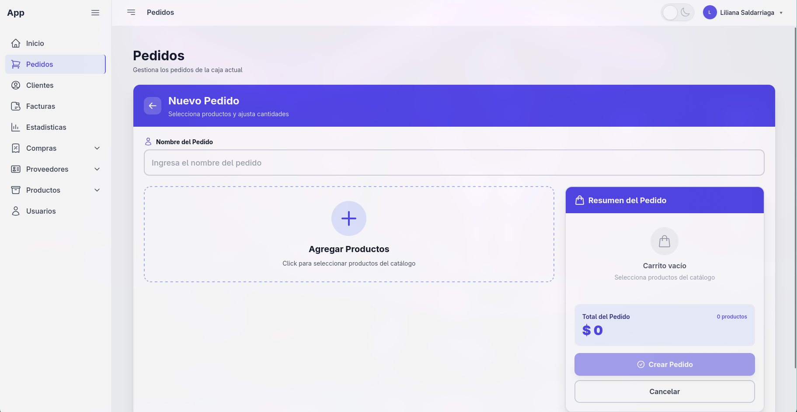
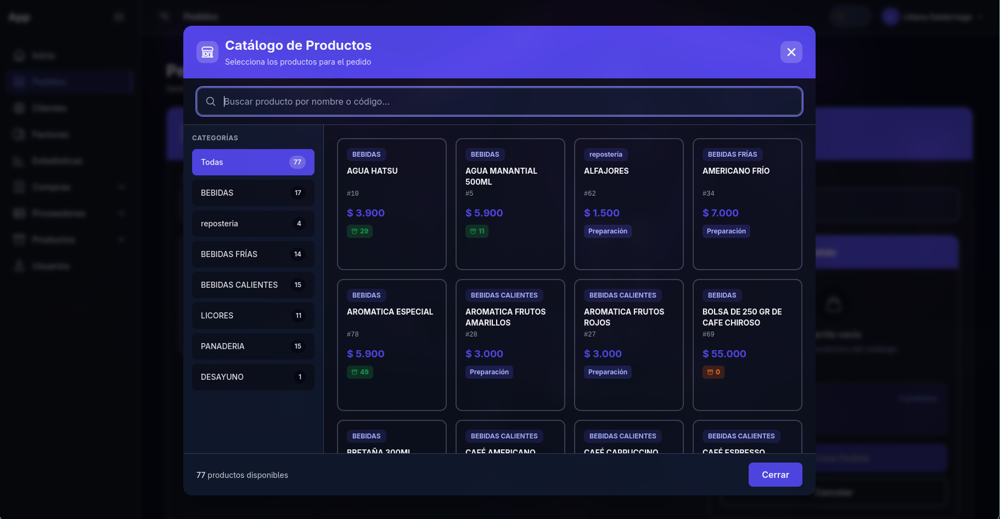
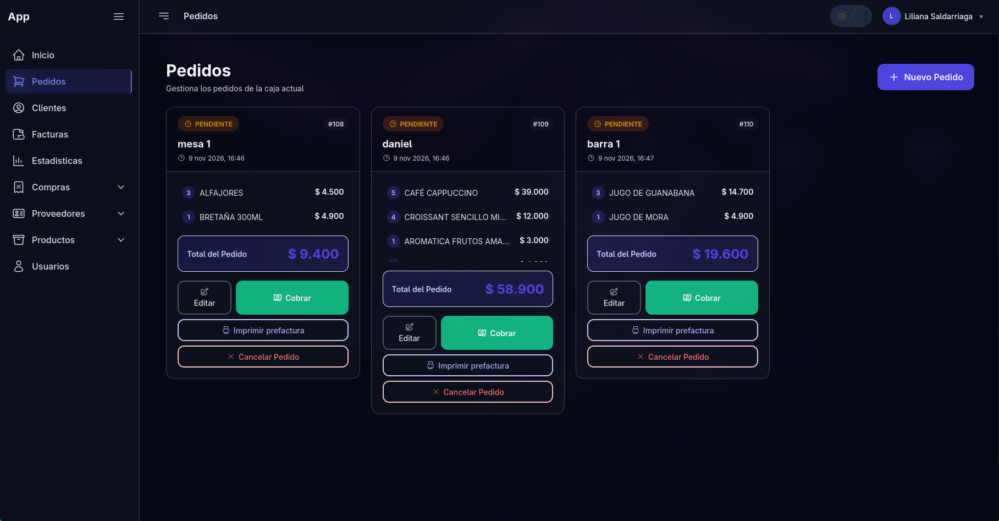
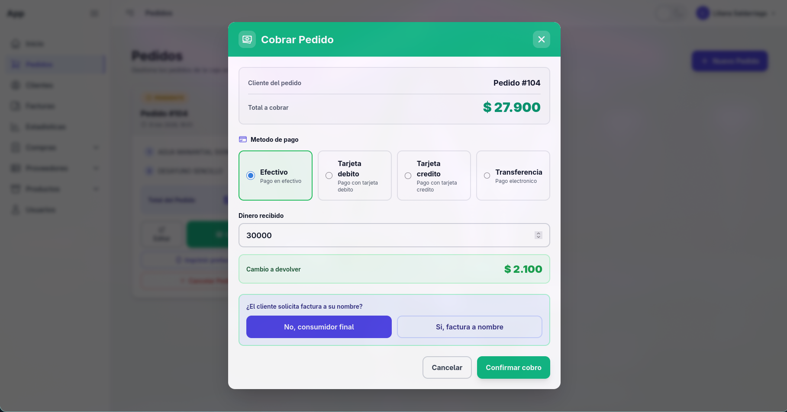
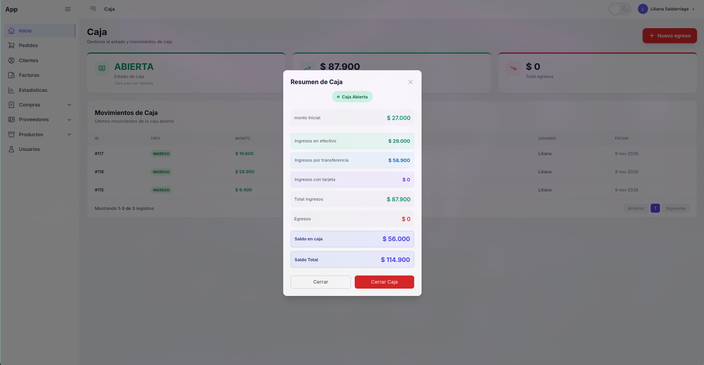
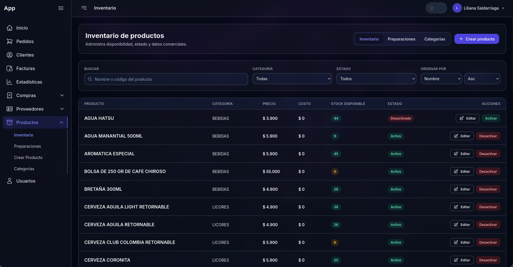
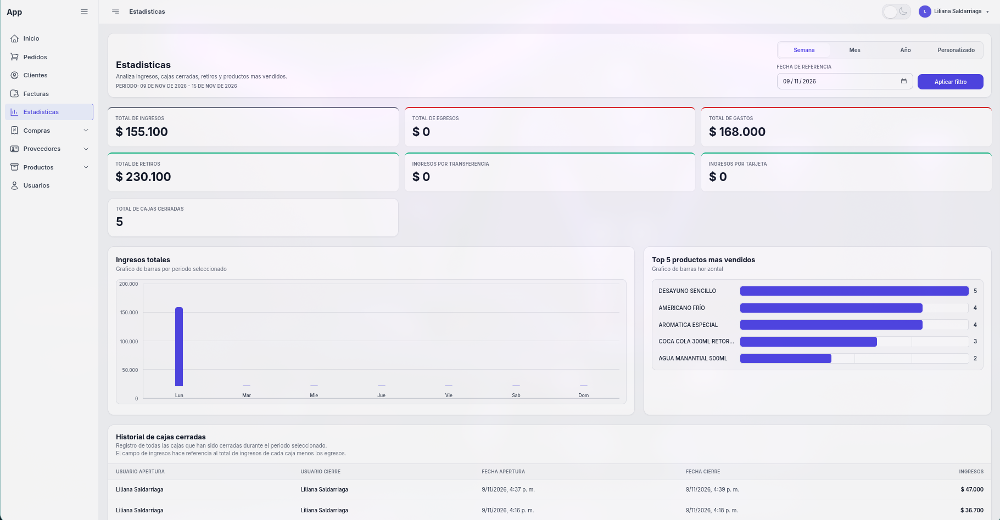
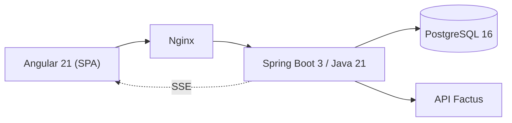

# Sistema de Facturación y POS Multi-Tenant

Aplicación web de **punto de venta (POS)**, **control de inventario**, **arqueo de caja** y **facturación electrónica en Colombia** a través de la API de **[Factus](https://factus.com.co)** (proveedor tecnológico). Arquitectura **multi-tenant**: varios negocios operan de forma aislada sobre una única instancia.

| Backend | Frontend | Base de datos | Despliegue |
|---|---|---|---|
| Java 21 · Spring Boot 3 | Angular 21 · Tailwind CSS | PostgreSQL 16 | Docker Compose · Nginx |

---

## Capturas de pantalla

### Pantallas

#### Inicio de sesión


#### Toma de pedidos


#### Toma de pedidos — lista de productos


#### Lista de pedidos


#### Cobro de pedido


#### Arqueo de caja


#### Lista de productos


#### Estadísticas


---

## Funcionalidades

### Punto de Venta (POS)
- Creación, edición y anulación de pedidos con productos inventariables y de preparación.
- Modificadores y notas predefinidas por grupo de categorías.
- Cobro multimétodo (efectivo, tarjeta, transferencia) con cálculo de cambio y pagos divididos.
- Actualización en tiempo real de pedidos mediante **Server-Sent Events (SSE)**.
- Tirillas de venta en PDF optimizadas para impresoras térmicas de 80 mm / 58 mm.

### Facturación Electrónica (Factus)
- Emisión de factura electrónica mediante la API de **Factus**, con mapeo de órdenes a su formato JSON.
- Máquina de estados fiscal para el ciclo de vida de cada documento.
- Reintentos programados para respuestas pendientes de validación (HTTP 409) mediante un scheduler.

### Caja y Arqueo
- Apertura de caja con base inicial y cierre con arqueo ciego; una sola caja abierta por negocio.
- Trazabilidad de ingresos, egresos, retiros y ventas cobradas.
- Conciliación automática de sobrantes y faltantes contra el saldo teórico del turno.

### Inventario y Compras
- Productos inventariables (existencias, stock mínimo y reservado) y productos de preparación.
- Parametrización de impuestos colombianos (IVA 0/5/19 % e INC 8 %).
- Registro de compras a proveedores con actualización automática de stock y kardex de auditoría.

### Administración (Super Admin)
- Alta de negocios inquilinos con creación del usuario administrador.
- Configuración de credenciales de Factus por negocio, cifradas en reposo (AES-256-GCM).
- Asignación de rangos de numeración autorizados.

### Reportes
- Ventas e ingresos por semana y mes en zona horaria `America/Bogota`.
- Margen operativo cruzando ingresos contra costos, ranking de productos más vendidos y desglose por método de pago.

---

## Arquitectura

Desacople cliente-servidor con aislamiento multi-tenant a nivel de servicio y entidad (`TenantContext` + `BaseTenantEntity`), bloqueos pesimistas para numeración y caja, y cifrado de secretos en reposo.



### Backend
- **Seguridad:** JWT (jjwt) + RBAC y contexto de inquilino por `ThreadLocal`.
- **Concurrencia:** bloqueos `PESSIMISTIC_WRITE` para evitar huecos en numeración y dobles envíos.
- **Criptografía:** cifrado AES-256-GCM para credenciales de Factus.
- **Tiempo real:** `SseEmitter` particionado por negocio.
- **Esquema:** migraciones Flyway versionadas (`ddl-auto=validate`).

### Frontend
- Angular 21 con componentes standalone, signals y TypeScript estricto; Tailwind CSS para la UI.

---

## Estructura del repositorio

```
.
├── Backend/facturacion negocio/     # API Spring Boot 3 (Java 21)
│   └── src/main/java/com/facturacion/negocio/
│       ├── controllers/             # REST y endpoints SSE
│       ├── domain/                  # Entidades JPA
│       ├── repository/              # Repositorios Spring Data JPA
│       ├── security/                # JWT, TenantContext, cifrado
│       ├── services/                # Lógica de negocio (POS, caja, Factus, reportes)
│       ├── scheduler/               # Reintentos de facturación
│       └── resources/db/migration/  # Migraciones Flyway
├── Cafeteria frontend/cafeteria-frontend/  # SPA Angular 21
│   └── src/app/
│       ├── core/                    # Servicios, guards e interceptores
│       ├── features/                # POS, caja, compras, reportes
│       └── shared/                  # Componentes y modales compartidos
└── deploy/                          # Docker Compose, Nginx y backups
```

---

## Puesta en marcha

### Requisitos
- JDK 21, Node.js 20+ y PostgreSQL 16 (solo si no usas Docker).
- Docker y Docker Compose para el despliegue completo.

### Opción A: Docker Compose (recomendado)

```bash
cp deploy/.env.example deploy/.env   # edita los valores CHANGE_ME
mkdir -p deploy/logos deploy/backups-data
docker compose --env-file deploy/.env -f deploy/docker-compose.yml up --build
```

- Frontend: http://localhost
- API: http://localhost/api/v1
- Health: http://localhost/api/v1/actuator/health

### Opción B: Desarrollo manual

```bash
# Backend
cd "Backend/facturacion negocio"
export SPRING_DATASOURCE_URL=jdbc:postgresql://localhost:5432/facturacion
export SPRING_DATASOURCE_USERNAME=postgres
export SPRING_DATASOURCE_PASSWORD=postgres
export JWT_SECRET="CHANGE_ME"
export APP_CRYPTO_SECRET="CHANGE_ME"
./mvnw spring-boot:run          # pruebas: ./mvnw test

# Frontend (nueva terminal)
cd "Cafeteria frontend/cafeteria-frontend"
npm install
npm start                        # pruebas: npm test
```

---

## Variables de entorno

Basadas en `deploy/.env.example`. Nunca versiones valores reales.

| Variable | Descripción |
|---|---|
| `SPRING_DATASOURCE_URL` / `_USERNAME` / `_PASSWORD` | Conexión JDBC a PostgreSQL |
| `JWT_SECRET` | Clave para firmar tokens JWT (mín. 32 bytes) |
| `APP_CRYPTO_SECRET` | Clave del cifrado AES-256-GCM |
| `FACTUS_URL` | URL de la API de Factus (`https://api-sandbox.factus.com.co`) |
| `FACTUS_USERNAME` / `FACTUS_PASSWORD` | Credenciales de Factus |
| `FACTUS_CLIENTID` / `FACTUS_CLIENTSECRET` | Cliente OAuth de Factus |
| `FACTUS_PREFIJO` | Prefijo de numeración fiscal |
| `ESTABLECIMIENTO_*` | Datos del establecimiento (nombre, NIT, dirección, etc.) |
| `SUPERADMIN_*` | Cuenta inicial de administración de plataforma |
| `APP_CORS_ALLOWED_ORIGINS` | Orígenes permitidos para CORS |
| `TIRILLA_FACTURA_LOGO_DIRECTORY` | Ruta de los logotipos para las tirillas |

---

## Estado actual

Implementado y validado de punta a punta:

- Autenticación JWT + RBAC y aislamiento multi-tenant.
- Flujo completo de POS, comandas, arqueo de caja y kardex de inventario.
- Tiempo real con SSE y tirillas PDF.
- Facturación electrónica funcional con **Factus** en ambiente sandbox.
- Concurrencia validada con pruebas de integración.
