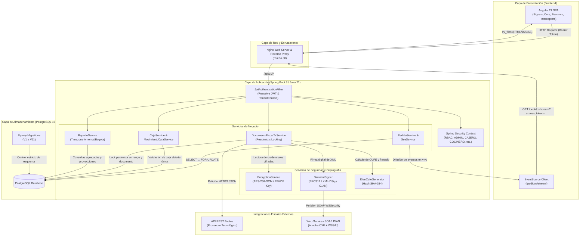

# Sistema de Facturación, POS y Gestión Comercial Multi-Tenant

Sistema web de gestión comercial para puntos de venta (POS), control de inventarios, arqueo de caja y emisión de facturación electrónica conforme a la normativa fiscal colombiana, diseñado sobre una arquitectura multi-inquilino (*multi-tenant*).

---

## Tabla de Contenidos

1. [Contexto y Propósito del Sistema](#contexto-y-propósito-del-sistema)
2. [Funcionalidades Principales por Módulo](#funcionalidades-principales-por-módulo)
3. [Arquitectura General](#arquitectura-general)
4. [Diagrama de Arquitectura](#diagrama-de-arquitectura)
5. [Stack Tecnológico](#stack-tecnológico)
6. [Decisiones Técnicas y Aspectos de Ingeniería](#decisiones-técnicas-y-aspectos-de-ingeniería)
7. [Organización del Repositorio](#organización-del-repositorio)
8. [Configuración y Variables de Entorno](#configuración-y-variables-de-entorno)
9. [Instrucciones de Ejecución Local](#instrucciones-de-ejecución-local)
10. [Alcance del Proyecto y Estado Actual](#alcance-del-proyecto-y-estado-actual)

---

## Contexto y Propósito del Sistema

El proyecto fue desarrollado para resolver las necesidades operativas y fiscales de comercios del sector gastronómico y de comercio minorista (cafeterías, restaurantes, retail). Estos negocios requieren agilidad en el punto de venta, coordinación en tiempo real entre servicio y cocina, control exhaustivo del flujo de caja e inventario, y cumplimiento de la regulación tributaria colombiana de facturación electrónica sin incurrir en soluciones monolíticas o dependientes de esquemas mono-empresa.

### Problemas de ingeniería abordados

- **Aislamiento de datos multi-empresa:** Garantizar la coexistencia segura de múltiples comercios dentro de una misma instancia de base de datos sin riesgo de contaminación cruzada (*cross-tenant data leakage*).
- **Concurrencia en facturación:** Prevenir condiciones de carrera en la asignación de numeración consecutiva fiscal autorizada por la DIAN y evitar duplicidad de cobros bajo concurrencia de cajeros.
- **Sincronización operativa en tiempo real:** Transmitir pedidos hacia áreas de preparación (cocina/barra) con latencia reducida y sin recargar el servidor mediante consultas periódicas (*polling*).
- **Seguridad y criptografía en reposo:** Almacenar de manera segura credenciales externas de integración tributaria y manipular certificados digitales conforme a estándares de firma electrónica.

---

## Funcionalidades Principales por Módulo

### 1. Terminal de Punto de Venta (POS) y Comandas
- **Gestión de pedidos:** Creación, edición y anulación de órdenes de venta con soporte para productos inventariables y productos de preparación en cocina.
- **Modificadores y notas predefinidas:** Inclusión de especificaciones culinarias organizadas por grupos de categorías (ej. términos de cocción, adiciones, exclusiones de ingredientes).
- **Cobro multimétodo:** Procesamiento de pagos divididos o únicos mediante efectivo, tarjeta de débito/crédito o transferencia electrónica, con cálculo automático de cambio.
- **Transmisión en tiempo real:** Comunicación instantánea del estado de los pedidos (`PENDIENTE`, `EN_PREPARACION`, `ENTREGADO`, `PAGADO`, `CANCELADO`) hacia pantallas de preparación mediante Server-Sent Events (SSE).
- **Impresión térmica:** Generación de pre-facturas de mesa y tirillas finales de venta en formato PDF optimizado para impresoras térmicas de 80 mm / 58 mm, con integración dinámica del logotipo del comercio.

### 2. Facturación Electrónica (Normativa DIAN)
- **Doble vía de emisión:** Arquitectura preparada para trabajar mediante Proveedor Tecnológico (integración REST con Factus) o conexión directa a los servicios web SOAP de la DIAN.
- **Cálculo de CUFE:** Algoritmo de generación del Código Único de Facturación Electrónica implementado con cifrado hash SHA-384 a partir de datos del emisor, adquirente, valores fiscales y clave técnica.
- **Firma digital XML:** Construcción y firmado de documentos XML UBL 2.1 utilizando certificados digitales X.509 en formato PKCS12 conforme al estándar XML-DSig con canonicalización C14N.
- **Máquina de estados fiscal:** Ciclo de vida controlado para documentos fiscales (`BORRADOR`, `PENDIENTE_ENVIO`, `ENVIADO_PT`, `ACEPTADO_DIAN`, `RECHAZADO`, `PENDIENTE_CONTINGENCIA`).
- **Resiliencia y reintentos:** Mecanismo programado (*scheduler*) para procesar documentos pendientes y resolver respuestas de validación diferida (HTTP 409 Conflict) emitidas durante períodos de alta carga del proveedor.

### 3. Arqueo y Control de Caja
- **Ciclo de turnos:** Apertura de caja con monto base inicial y cierre con arqueo ciego, respaldado por una restricción de unicidad en base de datos que impide múltiples cajas abiertas simultáneas por comercio.
- **Registro de movimientos:** Trazabilidad de ingresos manuales, egresos de efectivo, retiros para consignación y entradas automáticas provenientes de ventas cobradas.
- **Conciliación financiera:** Cálculo automático de diferencias (sobrantes/faltantes) contrastando el efectivo reportado físicamente contra el saldo teórico calculado del turno.

### 4. Inventario y Compras a Proveedores
- **Clasificación de productos:** Separación entre ítems inventariables (seguimiento de existencias, stock mínimo y stock reservado) y productos de preparación elaborados bajo pedido.
- **Gestión impositiva colombiana:** Parametrización individual de impuestos con soporte para Impuesto al Valor Agregado (IVA: 0%, 5%, 19%) e Impuesto Nacional al Consumo (INC: 8%), así como exenciones/exclusiones tributarias.
- **Registro de compras:** Ingreso de facturas de compras a proveedores con discriminación de costos unitarios e impuestos, actualizando automáticamente el stock disponible.
- **Kardex de auditoría:** Registro inmutable de transacciones de inventario vinculadas a compras, ventas, anulaciones o ajustes manuales.

### 5. Administración de Plataforma (Super Admin)
- **Aprovisionamiento de comercios:** Alta y gestión centralizada de negocios inquilinos con creación del usuario administrador principal.
- **Rangos de numeración:** Asignación y control de resoluciones de facturación autorizadas por la DIAN (prefijo, rango numérico desde/hasta, fecha de vigencia y clave técnica).
- **Configuración de credenciales seguras:** Parametrización aislada de credenciales del proveedor tecnológico por comercio, resguardadas mediante cifrado criptográfico.

### 6. Reportes y Métricas Comerciales
- **Agregaciones temporales:** Análisis de ventas e ingresos por rangos semanales y mensuales calculados bajo la zona horaria del negocio (`America/Bogota`).
- **Proyección de utilidad:** Cálculo de margen operativo cruzando los ingresos de venta contra los costos registrados de mercancía y compras.
- **Distribución de ingresos:** Desglose porcentual y numérico de recaudación clasificado por método de pago y ranking de productos más vendidos (*top-sellers*).

---

## Arquitectura General

El sistema implementa una arquitectura desacoplada cliente-servidor orientada al dominio comercial, con persistencia relacional y separación rigurosa de responsabilidades:

```
                                [ Cliente Web / Navegador ]
                                             │
                                             ▼ HTTP / SSE
                                  [ Nginx (Reverse Proxy) ]
                                             │
                        ┌────────────────────┴────────────────────┐
                        │ / (Archivos estáticos SPA)             │ /api/v1 (Proxy Pass)
                        ▼                                         ▼
            [ Angular 21 (SPA Frontend) ]            [ Spring Boot 3 (API Backend) ]
                                                                  │
                                      ┌───────────────────────────┼───────────────────────────┐
                                      ▼                           ▼                           ▼
                           [ Security / Multi-Tenant ]   [ Lógica de Dominio ]      [ Integración Fiscal ]
                           - JwtAuthenticationFilter     - PedidoService            - Proveedor Factus (REST)
                           - TenantContext (ThreadLocal) - CajaService              - DianCxfClient (SOAP/WSS4J)
                           - EncryptionService (AES-GCM) - ReporteService           - DianXmlSigner (XML-DSig)
                                      │                           │
                                      └─────────────┬─────────────┘
                                                    │ JPA / Hibernate (Flyway)
                                                    ▼
                                       [ PostgreSQL 16 Database ]
                                       - Esquema con segregación por negocio_id
                                       - Bloqueos pesimistas (PESSIMISTIC_WRITE)
                                       - Índices y restricciones de unicidad parcial
```

### Componentes clave del backend

1. **Capa de Controladores y SSE:** Controladores REST para operaciones CRUD y un controlador reactivo (`PedidoSseController`) que administra instancias de `SseEmitter` particionadas por negocio para despachar actualizaciones de pedidos en vivo.
2. **Capa de Seguridad e Intercepción:** `JwtAuthenticationFilter` extrae el token JWT (desde la cabecera `Authorization` o del parámetro de consulta `access_token` en flujos SSE), valida la expiración y existencia del usuario, verifica que el comercio se encuentre activo y establece el inquilino actual en `TenantContext`.
3. **Capa Transaccional y Control de Concurrencia:** `DocumentoFiscalTxService` y los repositorios de entidades críticas emplean anotaciones de aislamiento transaccional y bloqueos pesimistas para coordinar operaciones críticas de caja, pedidos y emisión fiscal.
4. **Capa de Criptografía:** `EncryptionService` provee cifrado simétrico autenticado para proteger secretos en reposo.
5. **Capa de Persistencia y Migraciones:** Base de datos PostgreSQL gestionada exclusivamente a través de migraciones Flyway que versionan la evolución del esquema relacional y aplican restricciones de integridad referencial.

---

## Diagrama de Arquitectura

El siguiente diagrama detalla la interacción entre las capas del sistema y los servicios externos durante el ciclo de vida de una operación comercial y fiscal:



---

## Stack Tecnológico

| Capa / Subsistema | Tecnología | Versión | Justificación Técnica |
|---|---|---|---|
| **Lenguaje Backend** | Java | 21 (LTS) | Tipado estático robusto, mejoras en gestión de memoria, records y características modernas del lenguaje. |
| **Framework Backend** | Spring Boot | 3.x | Ecosistema empresarial para APIs REST, inyección de dependencias y configuración declarativa. |
| **Seguridad** | Spring Security | 6.x | Configuración de seguridad sin estado (*stateless*), filtros HTTP personalizados y control de acceso basado en roles (*RBAC*). |
| **Tokens de Sesión** | jjwt (Java JWT) | 0.12.x | Generación y verificación criptográfica de tokens HMAC-SHA256 con claims personalizados (`negocioId`, `uid`, `rol`). |
| **Persistencia** | Spring Data JPA / Hibernate | 6.x | Mapeo objeto-relacional, composición de consultas y control de bloqueos a nivel de base de datos. |
| **Gestión de Esquema** | Flyway | Integrado | Migraciones incrementales reproducibles en base de datos; validación del esquema al arranque (`ddl-auto=validate`). |
| **Criptografía** | Java Cryptography Extension (JCE) | Estándar | Cifrado simétrico AES-256 en modo GCM para protección de secretos de integración en base de datos. |
| **Integración SOAP / XML** | Apache CXF / WSS4J | 4.x / 3.x | Consumo de servicios web SOAP de la DIAN, generación de clientes desde WSDL y aplicación de WS-Security. |
| **Firma Digital** | JSR 105 (XML Digital Signature) | Estándar | Firma electrónica de facturas XML con certificados digitales X.509 en contenedores PKCS12. |
| **Generación Documental** | OpenHTMLtoPDF (PDFBox) | 1.0.x | Conversión de plantillas HTML/CSS a documentos PDF para impresión térmica con renderizado dinámico de logotipos. |
| **Base de Datos** | PostgreSQL | 16 | Motor relacional con soporte para restricciones parciales, tipos numéricos de precisión fija (`numeric`) e índices concurrentes. |
| **Framework Frontend** | Angular | 21 | Arquitectura moderna basada en componentes standalone, signals, inyección funcional y TypeScript estricto. |
| **Estilos UI** | Tailwind CSS | 3.x | Sistema de diseño utilitario para interfaces ágiles, ligeras y con adaptabilidad a terminales de punto de venta. |
| **Servidor Web / Proxy** | Nginx | Alpine | Servidor web de alto rendimiento para servir la SPA y proxy inverso que redirige el tráfico hacia el backend. |
| **Contenedores** | Docker & Docker Compose | Moderno | Empaquetado estandarizado de dependencias y servicios con definición de redes aisladas y healthchecks. |

---

## Decisiones Técnicas y Aspectos de Ingeniería

### 1. Aislamiento Multi-Tenant en Contexto de Ejecución y Dominio
Para permitir que múltiples negocios utilicen la aplicación de manera aislada sobre un único esquema de datos, se implementó un mecanismo doble:
- **`TenantContext` mediante `ThreadLocal`:** Durante la autenticación en `JwtAuthenticationFilter`, el identificador del inquilino (`negocioId`) contenido en el JWT se asocia al hilo de ejecución actual tras verificar que el negocio exista y esté activo en la base de datos. En el bloque `finally` de la petición, se invoca `TenantContext.clear()` para garantizar la liberación del recurso y prevenir fugas de contexto en el pool de hilos de Tomcat.
- **Validación transversal en `BaseTenantEntity`:** Todas las entidades pertenecientes a un comercio heredan de `BaseTenantEntity`. Cuando una entidad se asocia con otra entidad dependiente o con un usuario, el método `heredarNegocio` valida estrictamente que ambas pertenezcan al mismo `negocio_id`. En caso de inconsistencia, se lanza un `IllegalArgumentException`, impidiendo alteraciones indebidas de relaciones entre comercios.

### 2. Control de Concurrencia Pesimista en Numeración y Estados Fiscales
En un entorno con varios cajeros operando en paralelo, la asignación de números de factura consecutiva y las transiciones de estado de emisión fiscal son vulnerables a condiciones de carrera. Para resolverlo:
- Se implementaron bloqueos pesimistas de escritura (`@Lock(LockModeType.PESSIMISTIC_WRITE)`) en `NumberingRangeRepository`, `DocumentoFiscalRepository`, `PedidoRepository` y `CajaRepository`.
- La consulta SQL genera una cláusula `SELECT ... FOR UPDATE` a nivel de fila en PostgreSQL, obligando a que transacciones concurrentes esperen la finalización del incremento o actualización de estado en curso, eliminando huecos en la correlación fiscal o dobles envíos al proveedor externo.

### 3. Cifrado en Reposo de Credenciales de Terceros (AES-256-GCM)
Las credenciales de integración de cada comercio con el proveedor tecnológico (claves de API, tokens y secretos de cliente) se almacenan en la base de datos protegidas criptográficamente:
- La clase `EncryptionService` utiliza el algoritmo simétrico **AES en modo Galois/Counter Mode (GCM) sin padding**, proporcionando confidencialidad y verificación de integridad.
- Para cada operación de cifrado se genera un vector de inicialización (IV) criptográficamente seguro de 12 bytes mediante `SecureRandom`, el cual se almacena junto al texto cifrado y al tag de autenticación de 128 bits. La clave maestra se deriva a partir de la variable de entorno `APP_CRYPTO_SECRET` mediante SHA-256.

### 4. Sincronización en Tiempo Real mediante SSE y Autenticación de EventSource
Para mantener actualizadas las pantallas de cocina y pedidos sin incurrir en la sobrecarga de consultas recurrentes:
- Se implementó Server-Sent Events (SSE) a través de `SseService`, administrando listas de suscriptores concurrentes (`CopyOnWriteArrayList`) dentro de un mapa indexado por inquilino (`ConcurrentHashMap`).
- Dado que la interfaz estándar `EventSource` de los navegadores web no admite el envío de cabeceras HTTP personalizadas (como `Authorization: Bearer`), `JwtAuthenticationFilter` incorpora soporte específico para la ruta `/pedidos/stream`, permitiendo la lectura segura del token a través del parámetro de consulta `access_token`.

### 5. Doble Vía de Integración Fiscal Colombiana
El diseño del módulo fiscal desacopla la lógica de negocio del proveedor de emisión:
- **Proveedor Tecnológico (Factus):** Cliente HTTP que realiza el mapeo de órdenes a la estructura JSON exigida por Factus. Gestiona de forma controlada las respuestas HTTP 409 (en proceso de validación en la DIAN) mediante reintentos diferidos en `DocumentoFiscalScheduler`.
- **Servicio Directo DIAN:** Implementación de generación de CUFE conforme a la ficha técnica oficial mediante SHA-384 (`DianCufeGenerator`), serialización del estándar UBL 2.1, firmado digital XML-DSig con canonicalización C14N (`DianXmlSigner`) y transporte SOAP sobre Apache CXF con validación mediante certificados PKCS12 (`.p12`).

### 6. Esquema Evolutivo mediante Migraciones Flyway
La estructura de base de datos no depende de la generación automática de Hibernate (`spring.jpa.hibernate.ddl-auto=validate`). La integridad y evolución del esquema se gestiona a través de 11 migraciones SQL versionadas (`V1` a `V11`), permitiendo auditar cambios como:
- Restricciones de una única caja abierta por negocio mediante índices parciales únicos (`V7__caja_abierta_unica_por_negocio.sql`).
- Snapshot de tarifas de impuestos por detalle de orden al momento de la venta (`V10__detalle_pedido_impuesto_snapshot.sql`).
- Costos de producto para cálculo de rentabilidad (`V11__producto_costo.sql`).

---

## Organización del Repositorio

El repositorio se estructura en tres directorios principales que separan backend, frontend e infraestructura de despliegue:

```
.
├── Backend/facturacion negocio/              # Módulo del Backend (Spring Boot 3)
│   ├── pom.xml                               # Configuración de dependencias Maven
│   ├── mvnw / mvnw.cmd                       # Maven Wrapper
│   └── src/
│       ├── main/
│       │   ├── java/com/facturacion/negocio/
│       │   │   ├── config/                   # Configuración Spring (CORS, zona horaria, crypto)
│       │   │   ├── controllers/              # Controladores REST y endpoints SSE
│       │   │   ├── domain/                   # Entidades JPA (BaseTenantEntity, Pedido, etc.)
│       │   │   ├── dto/                      # Data Transfer Objects (peticiones y respuestas)
│       │   │   ├── enumerated/               # Enumeraciones de dominio (Rol, Estado, etc.)
│       │   │   ├── repository/               # Repositorios Spring Data JPA con bloqueos
│       │   │   ├── scheduler/                # Tareas programadas (DocumentoFiscalScheduler)
│       │   │   ├── security/                 # Seguridad JWT, TenantContext y EncryptionService
│       │   │   ├── services/                 # Lógica de negocio (Caja, Pedido, Reportes, DIAN)
│       │   │   └── utils/                    # Funciones utilitarias y normalización
│       │   └── resources/
│       │       ├── application.properties    # Propiedades base de desarrollo
│       │       ├── application-prod.properties # Propiedades para despliegue productivo
│       │       └── db/migration/             # Migraciones Flyway (V1__ a V11__)
│       └── test/                             # Pruebas unitarias y de concurrencia
│
├── Cafeteria frontend/cafeteria-frontend/    # Módulo del Frontend (Angular 21)
│   ├── package.json                          # Dependencias npm y scripts de ejecución
│   ├── angular.json                          # Configuración de compilación de Angular
│   └── src/app/
│       ├── core/                             # Servicios singleton, guards e interceptores HTTP
│       ├── features/                         # Módulos de funcionalidad (POS, caja, compras, etc.)
│       ├── layout/                           # Componentes de navegación y estructura visual
│       └── shared/                           # Componentes compartidos, modales y tickets
│
└── deploy/                                   # Infraestructura y Despliegue
    ├── docker-compose.yml                    # Orquestación de Backend, Frontend/Nginx y Postgres
    ├── .env.example                          # Plantilla de variables de entorno para Docker
    ├── backend/                              # Dockerfile y empaquetado del Backend
    ├── nginx/                                # Dockerfile y configuración del Reverse Proxy
    └── backups/                              # Scripts y plantilla (.env.example) para copias de seguridad
```

---

## Configuración y Variables de Entorno

Toda la configuración sensible y parametrizable se gestiona a través de variables de entorno, evitando la presencia de secretos en el código fuente.

### Variables principales (basadas en `deploy/.env.example`)

| Variable | Descripción | Ejemplo / Valor por defecto |
|---|---|---|
| `SPRING_PROFILES_ACTIVE` | Perfil activo de Spring Boot | `prod` o `default` |
| `SPRING_DATASOURCE_URL` | Cadena JDBC de conexión a PostgreSQL | `jdbc:postgresql://db:5432/facturacion` |
| `SPRING_DATASOURCE_USERNAME` | Usuario de la base de datos | Parametrizado por el entorno |
| `SPRING_DATASOURCE_PASSWORD` | Contraseña de la base de datos | Parametrizado por el entorno |
| `POSTGRES_USER` | Usuario administrativo de PostgreSQL | Parametrizado por el entorno |
| `POSTGRES_PASSWORD` | Contraseña administrativa de PostgreSQL | Parametrizado por el entorno |
| `APP_CORS_ALLOWED_ORIGINS` | Orígenes permitidos para peticiones CORS | `http://localhost,http://localhost:4200` |
| `JWT_SECRET` | Clave secreta para firma y validación de tokens JWT (mínimo 256 bits) | Cadena aleatoria segura |
| `APP_CRYPTO_SECRET` | Clave secreta para el servicio de cifrado AES-256-GCM | Cadena aleatoria segura |
| `FACTUS_URL` | URL base de la API del proveedor tecnológico Factus | `https://api-sandbox.factus.com.co` |
| `SUPERADMIN_USERNAME` | Nombre de usuario inicial para la cuenta de plataforma | Parametrizado por el entorno |
| `SUPERADMIN_PASSWORD` | Contraseña inicial para la cuenta de plataforma | Parametrizado por el entorno |
| `DIAN_CERTIFICATE_HOST_PATH` | Ruta local al certificado digital PKCS12 (.p12) | Montado como volumen en Docker |
| `LOGOS_HOST_DIRECTORY` | Directorio local donde se almacenan los logotipos para tickets | `./logos` |

---

## Instrucciones de Ejecución Local

### Requisitos previos
- **Java Development Kit (JDK):** Versión 21 o superior.
- **Node.js:** Versión 20.x o superior con npm.
- **Base de datos relacional:** PostgreSQL 16 (si se ejecuta sin Docker).
- **Herramienta de contenedores:** Docker y Docker Compose (recomendado para despliegue completo).

---

### Opción A: Despliegue con Docker Compose (Recomendado)

1. **Preparar el archivo de configuración:**
   ```bash
   cp deploy/.env.example deploy/.env
   ```
   Abra `deploy/.env` y asigne valores seguros a los campos identificados con `CHANGE_ME`.

2. **Crear directorios locales requeridos:**
   ```bash
   mkdir -p deploy/logos deploy/backups-data
   ```

3. **Iniciar los servicios:**
   Desde la raíz del repositorio, ejecute:
   ```bash
   docker compose --env-file deploy/.env -f deploy/docker-compose.yml up --build
   ```

4. **Acceder a la aplicación:**
   - **Frontend (Aplicación Web):** `http://localhost`
   - **Backend API (a través del proxy):** `http://localhost/api/v1`
   - **Verificación de salud del Backend:** `http://localhost/api/v1/actuator/health`

---

### Opción B: Ejecución Manual en Entorno de Desarrollo

#### 1. Configuración de PostgreSQL
Asegúrese de tener una instancia de PostgreSQL 16 en ejecución con una base de datos denominada `facturacion`.

#### 2. Ejecutar el Backend
Navegue al directorio del backend y configure las variables de entorno básicas de desarrollo:

```bash
cd "Backend/facturacion negocio"

# Exportar variables mínimas requeridas (ejemplo para entorno local)
export SPRING_DATASOURCE_URL=jdbc:postgresql://localhost:5432/facturacion
export SPRING_DATASOURCE_USERNAME=postgres
export SPRING_DATASOURCE_PASSWORD=postgres
export JWT_SECRET="CHANGE_ME_JWT_SECRET"
export APP_CRYPTO_SECRET="CHANGE_ME_CRYPTO_SECRET"

# Iniciar la aplicación
./mvnw spring-boot:run
```

Para ejecutar las pruebas unitarias y de concurrencia:
```bash
./mvnw test
```

#### 3. Ejecutar el Frontend
Abra una nueva terminal y navegue al directorio del frontend:

```bash
cd "Cafeteria frontend/cafeteria-frontend"

# Instalar dependencias
npm install

# Iniciar servidor de desarrollo (por defecto en http://localhost:4200)
npm start
```

Para ejecutar la suite de pruebas del frontend:
```bash
npm test
```

---

## Alcance del Proyecto y Estado Actual

El sistema se presenta como un proyecto de ingeniería completo que demuestra capacidades de desarrollo full-stack, diseño de arquitectura de software, concurrencia y tratamiento de regulaciones fiscales:

- **Completamente implementado y validado:**
  - Sistema de autenticación con JWT y control de acceso basado en roles (*RBAC*).
  - Arquitectura multi-tenant con aislamiento de datos a nivel de capa de servicio y entidad.
  - Flujo integral de punto de venta (POS), comandas, arqueo de caja y kardex de inventario.
  - Generación de documentos térmicos de facturación en formato PDF.
  - Transmisión en tiempo real de estados de pedidos mediante Server-Sent Events (SSE).
  - Integración funcional con el Proveedor Tecnológico Factus para facturación electrónica en ambiente sandbox.
  - Bloqueos de concurrencia pesimista probados mediante pruebas de integración concurrentes (`DocumentoFiscalServiceConcurrencyTest`).

- **Módulo de conexión directa con la DIAN:**
  - Se encuentran construidas y validadas las capas de cálculo de CUFE (SHA-384), construcción del XML UBL 2.1, firmado digital XML-DSig con certificados PKCS12 y la definición del cliente SOAP con Apache CXF y WSS4J.
  - La operación en modo directo requiere que el usuario disponga de un certificado de firma digital válido emitido por una entidad de certificación abierta (ONAC) y un set de pruebas activo en la plataforma de habilitación de la DIAN.
